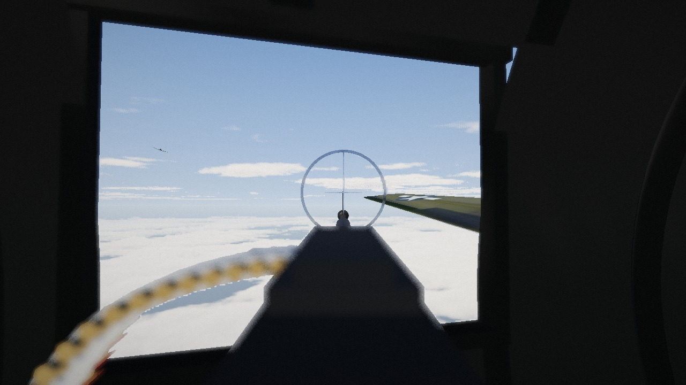
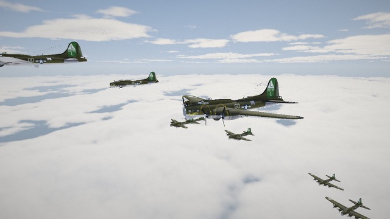
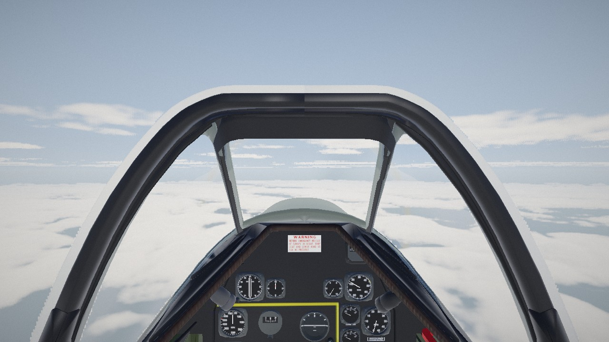
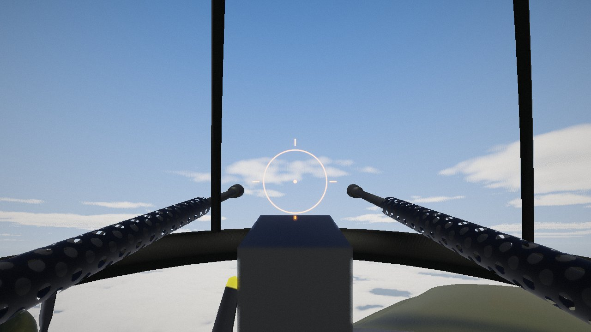

# Sky War Shooter 3D

A WWII air-combat game for desktop browsers. Man the .50-calibre guns of a B-17G Flying Fortress
in a combat box at 25,000 ft, or fly a P-51D Mustang as close escort, against Focke-Wulf Fw 190s.



The look is modelled on the waist-gunner shot (0:54–0:58) of Yarnhub's animated short
*When a B-17 Pilot Attacked the Copilot*: the gunner's view down a Browning M2 with a ring-and-post
sight, the ammunition belt curling in from the left, the dark fuselage framing a bright window, and
the bomber formation above a sea of cumulus. Reference frames are in `reference/video-frames/`.

| | |
|---|---|
|  |  |
|  | |

## Play

```bash
npm install
npm run dev
```

Open http://127.0.0.1:5173 in a desktop browser (Chrome, Edge, Firefox or Safari) with hardware
acceleration enabled. Mouse and keyboard only. Click the game to capture the mouse; **Esc** pauses.

### Modes
* **Campaign**: seven missions (Emden, Bremen, Ludwigshafen, Leipzig escort, Schweinfurt, a lone
  straggler fighting its way home, and the Berlin escort). Each mission unlocks the next; medals and
  best scores are saved in the browser.
* **Survival**: endless, escalating waves as a B-17 gunner or a P-51 escort pilot, with a local
  high-score table.

### Controls

**B-17 gunner**

| Input | Action |
|---|---|
| Mouse | Traverse the gun (heavy, sprung mount) |
| Left button | Fire (short bursts: the barrel overheats) |
| Right button | Look down the sight (zoom) |
| 1–5 | Left waist, right waist, top turret, ball turret, tail gun |
| R | Reload |

**P-51D pilot**

| Input | Action |
|---|---|
| Mouse | Mouse-aim flight: the aircraft flies where you look |
| Left button / Space | Fire the six .50s (harmonised at 300 yd) |
| W / S | Throttle |
| Q / E, A / D | Roll, rudder overrides |
| V | Cockpit / chase view |
| C (hold) | Free look |
| M | Toggle mouse aim / direct stick |
| Right button | Zoom |

Settings cover mouse sensitivity, Y inversion, volume, radio voices, graphics quality, target
markers (switch off for a purer simulation) and the P-51 control mode.

## How it works

* **Rendering**: Three.js (WebGL 2) with a reversed-Z depth buffer.
  * Raymarched volumetric clouds: a dense cumulus layer below the formation plus scattered cumulus above.
  * Aerial perspective, PBR aircraft lit by the sky's environment map, and sun shadows.
  * HDR post-processing: bloom, camera motion blur, near-field depth of field like the film, filmic tone mapping and grading.
* **Simulation**:
  * Fixed-wing flight model: power and drag, lift from angle of attack with stall, G limit and G blackout.
  * Ballistic rounds with gravity and inherited aircraft velocity, so you have to lead your target.
  * Per-zone damage for engines, wings, tail and cockpit, with fires, smoke trails, explosions, bail-outs and flak.
* **AI**:
  * Luftwaffe pilots run head-on, stern, beam and high-side attacks. They drop their belly tanks, break away under the box, extend and come back. They turn to fight escorts that jump them.
  * Your own crew and every other bomber's gunners man their turrets.
* **Audio**: fully procedural Web Audio.
  * Wright Cyclone drone inside the bomber, Merlin engine, Doppler-shifted fighter fly-bys, and positioned gunfire, flak and impacts with speed-of-sound delay.
  * Crew radio callouts with subtitles, spoken through the browser's speech synthesis.

```
src/
  core/      Engine (renderer + frame pipeline), Input
  render/    Sky, volumetric Clouds, PostFX, Particles/tracers, noise, atmosphere
  world/     Aircraft, FlightModel, AI, Ballistics, Effects, World, B-17 station layout
  game/      Game (menus, director, scoring), Missions, Gunner/Pilot controllers, Viewmodels
  audio/     Sound (procedural)
  ui/        UI (DOM screens, HUD)
  dev/       autoplay harness for automated playtests (dev builds only)
tools/
  convert_models/   FlightGear AC3D -> glTF converter (Blender), configs and reports
  frame2jpg.py      decode a canvas capture saved by the playtest tooling
```

### Build

```bash
npm run build      # type-check + production bundle in dist/
npm run preview
```

`dist/` is a static site and can be hosted anywhere (GitHub Pages, Netlify, S3).

### Automated playtests

Headless browser tabs don't fire `requestAnimationFrame`, so the dev build exposes hooks on
`window.sws`:
* `sws.step(n, dt)` advances the simulation.
* `sws.shot()` returns a JPEG data URL of the current frame.
* `sws.autoplay(sws.CAMPAIGN[i])` plays a whole mission with a scripted gunner or pilot and returns a log.

## Credits and licence

* **Aircraft models:** from the FlightGear open-source hangar, converted with `tools/convert_models`. Authors are listed in [public/models/CREDITS.md](public/models/CREDITS.md):
  * B-17G: Emmanuel Baranger et al.
  * Fw 190 A-8: Detlef Faber.
  * P-51D: Jim Wilson, Hal V. Engel et al.
* **Licence:** the models are GPL v2, so the whole game is distributed under the
  **GNU General Public License v2 or later** (see `LICENSE`).
* **Visual reference:** Yarnhub. No footage or assets from the video are used.
* **Names:** all characters, crews and bomber names are fictional.
