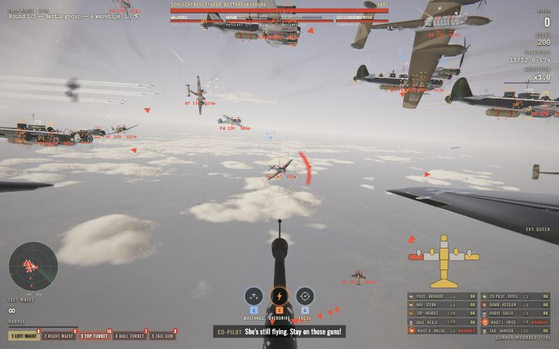
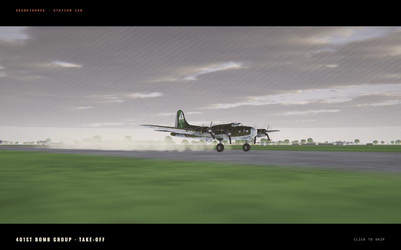
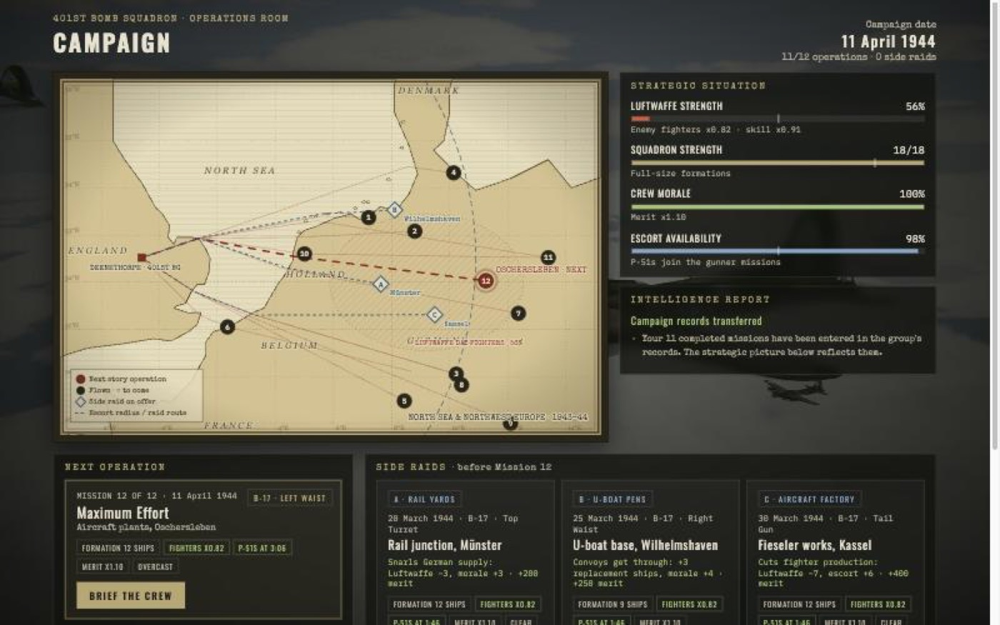
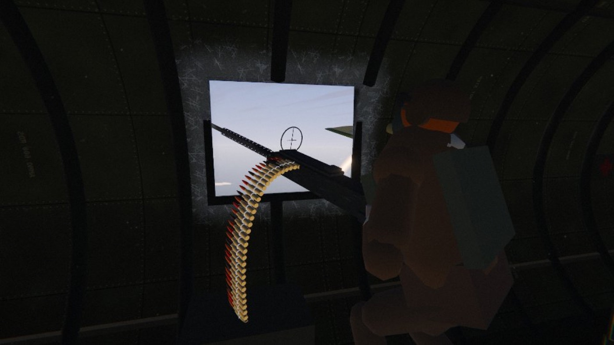
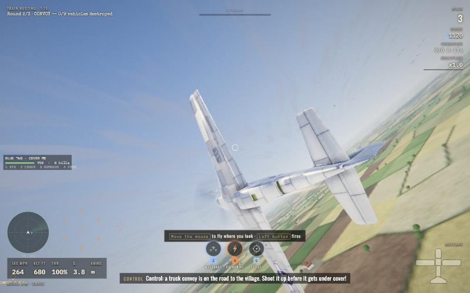
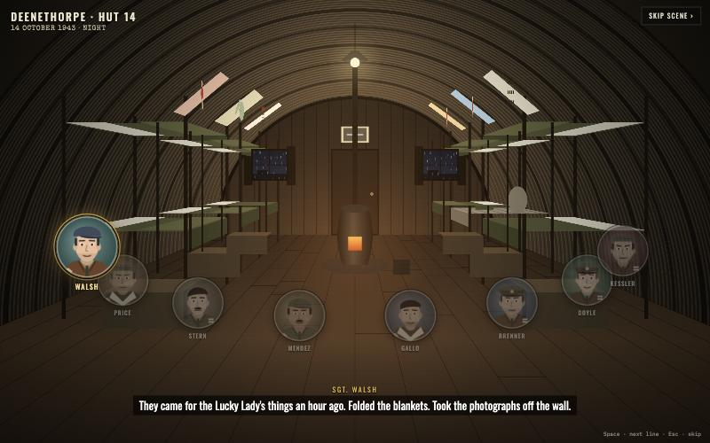
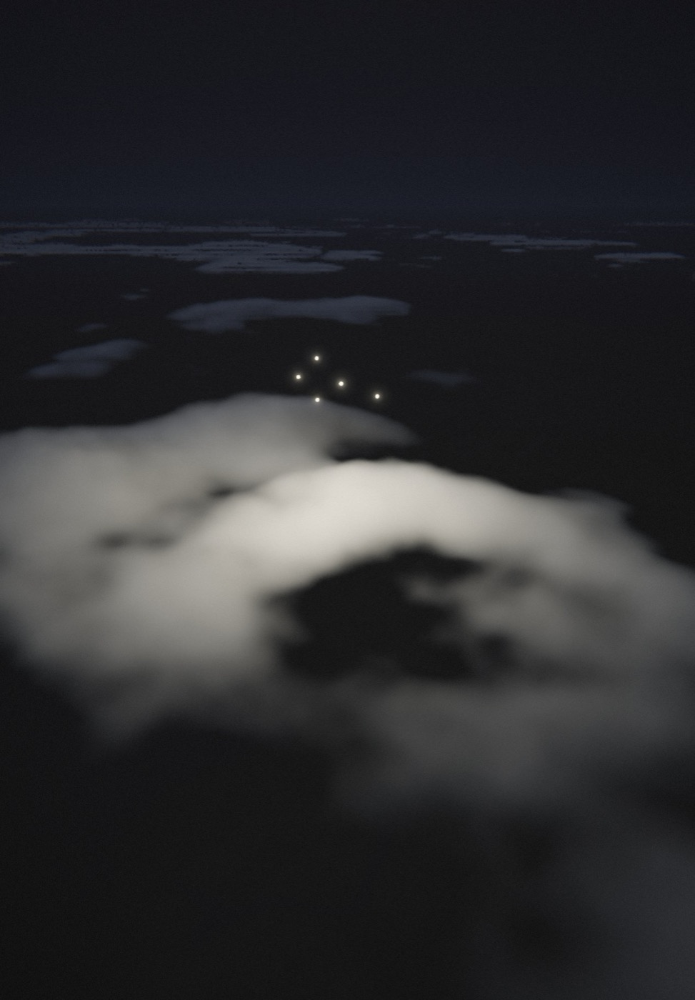

# Sky War Shooter 3D

A WWII air-combat game for the browser. Man the .50-calibre guns of a B-17G Flying Fortress
in a combat box at 25,000 ft, or fly a P-51D Mustang as close escort, against the Luftwaffe:
Fw 190s, Bf 109s, Bf 110s, Ju 88s, Me 262 jets, Me 163 rockets and battle groups of giant warships.



The look is modelled on the waist-gunner shot (0:54–0:58) of Yarnhub's animated short
*When a B-17 Pilot Attacked the Copilot*: the gunner's view down a Browning M2 with a ring-and-post
sight, the ammunition belt curling in from the left, the dark fuselage framing a bright window, and
the bomber formation above a sea of cumulus. Reference frames are in `reference/video-frames/`.

| | |
|---|---|
|  |  |
|  |  |
|  |  |

## Play

**Live:** https://sky-war-shooter-3d.mhamadhazeem2001.workers.dev (installable; plays offline after the first visit).

```bash
npm install
npm run dev        # http://127.0.0.1:5173
```

Desktop browsers with mouse and keyboard, gamepads, and phones/tablets (touch controls) are supported.
English and Arabic (right-to-left) under Settings → Language.

### Modes
* **Campaign**: 12 story missions from Emden (Sept 1943) to the Berlin finale (1944) with voiced
  briefings, played on a **strategic campaign map**. Between story missions you can fly optional
  side raids (rail yards, airfields, oil, U-boat pens, factories) that change Luftwaffe strength,
  squadron size, crew morale and escort availability. Missions m5, m7 and m12 end in a **boss
  battle** against a group of giant flying warships. After the story, volunteer for a **second tour**:
  25 generated operations earn a medal, then operations continue indefinitely, with both flight roles,
  late-war fighters, changing weather and a battle group every fifth operation.
* **Survival**: endless rounds as a B-17 gunner or P-51 pilot, with a hangar between rounds
  (aircraft, weapons, upgrades), weather that changes per round and a boss group every third round.
* **Hold the Field** (under Survival): man a quad .50 or 40 mm Bofors in a ground gun pit. Protect the control tower and parked B-17s from endless raids; keys 1–3 switch pits, R reloads. Choose a repair or upgrade between waves, in clear, overcast, storm, dusk or night weather.
* **Ace Hunt, Time Attack, Daily Run, Weekly Challenge**: online leaderboards (Firebase).
* **Special operations (P-51)**: *Defend the Field* (role reversal: Ju 88 raids on your airfield),
  *Night Fighter* (searchlights, flares, exhaust flames) and *Train Busting* (low-level strafing of
  trains, convoys and airfields over a procedural Normandy countryside, with 20 mm flak firing back).
  You lead a wingman with orders on keys 1–4.
* **Custom Battle**: pick role, seat, enemy types, numbers, skill, rounds, weather, time of day,
  weather fronts, boss round, special events, flak and escorts.
* **Co-op (beta)**: up to four players crew one B-17 or two players fly P-51 escorts over the internet (6-character room code). P-51 co-op supports Survival, campaign escort sorties and saved Custom Battle escort settings.
* **Training**: a 2-minute gunnery course.

### Progression
Career ranks and medals, 42 achievements, daily orders, a persistent **skill tree** (18 skills in
three branches), loot crates with weapon mods and cosmetics, bomber customisation (name, nose art,
paint), a crew of ten named men with levels and wounds, and cloud save via a private transfer code.
A roster of named Luftwaffe **Experten** remembers you: aces come back with scars and grudges, get
promoted, and carry bounties (Career → Experten). Campaign missions open with a dawn take-off from
Deenethorpe and end with a landing (a belly landing when the Sky Queen is badly damaged); weather
fronts roll in mid-mission. The **replay theatre** saves your best moments (scrub, free camera,
photo mode), and the **aircraft gallery** shows every type in 3D with a recognition quiz. The
**Field Manual** (title menu, pause menu, Settings, or "Full manual" on the H card) explains every
system in nine short illustrated chapters, with a controls reference that follows your key bindings.

### Controls

**B-17 gunner**

| Input | Action |
|---|---|
| Mouse | Traverse the gun (heavy, sprung mount) |
| Left button / Space | Fire (short bursts: the barrel overheats) |
| Right button / B | Look down the sight (zoom) |
| 1–5 | Left waist, right waist, top turret, ball turret, tail gun |
| R | Reload |
| N / gamepad Y | Take the bombsight during a bomb run; press again to return |
| Arrows / stick (bombsight) | Left/right correct course; up/down adjust the tracking rate |
| Space / RT, B / LT (bombsight) | Release manually; hold release to wait for a cloud gap |
| Q / E / G | Abilities: call the Mustangs, Overdrive, Focus |
| X / O | Random events: fire extinguisher, oxygen check |
| Tab | Big radar map (shows where the next wave will come from) |
| F | Photo mode |
| H | Controls card |

**P-51D pilot**

| Input | Action |
|---|---|
| Mouse | Mouse-aim flight: the aircraft flies where you look |
| Left button / Space | Fire the six .50s (harmonised at 250 m) |
| W / S | Throttle |
| Q / E, A / D | Roll, rudder overrides |
| T | Padlock view on the nearest bandit |
| V | Cockpit / chase view |
| C (hold) | Free look |
| M | Toggle mouse aim / direct stick |
| Z / X / G | Abilities |

In B-17 co-op, press U or the Ping target button to share a target or clock-direction callout.

Keys are remappable (Settings → Controls). Settings also cover difficulty, aim assist, lead
indicator, field of view, volumes, radio voices, graphics quality (Low/Medium/High/Ultra, with
dynamic resolution and 120/144 Hz support), an FPS counter, colour-blind markers, subtitle size,
reduced shake/flashes, kill cam and anonymous stats.

## Combat design

* **You are the decisive gun.** Fighters attacking your bomber fly their passes *through the field of fire of the gun position you are manning*: they form up out beyond your window or turret, run in on a collision course while firing, flash past close by, and loop back for another pass.
* **Readable targets.** Enemy fighters are drawn and hit larger than life. A health bar appears on any fighter you are hitting, and it takes about 20 hits to bring one down, with smoke, then black smoke, then fire as it weakens.
* **Your allies don't do your job.** The other crews' fire and the escorts mostly keep heads down rather than scoring kills.
* **How they go down:** wings and tails are shot away and the pieces tumble apart (the model is cut with clipping planes), or the fighter blows up or spins in burning, and pilots sometimes bail out.

## How it works

* **Rendering**: Three.js (WebGL 2) with a reversed-Z depth buffer.
  * Raymarched volumetric clouds with depth-aware upsampling, and per-mission time of day (from high summer sun to golden-hour winter light).
  * Condensation trails streaming from every bomber engine.
  * A second pass draws transparent effects (contrails, tracers, smoke, glass) over the clouds.
  * HDR post-processing: bloom with lens dirt, sun lens flare (occluded by aircraft and clouds), camera motion blur, near-field depth of field, filmic grading and trauma-based camera shake.
  * Procedural riveted-aluminium interior and parkerised gun textures. Bullet holes let in pinpoints of daylight and dusty sunbeams.
  * Explosions with fireball, shockwave, burning debris and lingering smoke.
* **Simulation**:
  * Fixed-wing flight model: power and drag, lift from angle of attack with stall, AoA and G limiter in mouse-aim mode, G blackout.
  * Ballistic rounds with gravity and inherited aircraft velocity, so you have to lead your target.
  * Per-zone damage with fires that spread into the wing, the pilot's engine fire extinguishers, bail-outs, flak and Wgr. 21 rocket salvos fired into the formation.
* **AI**:
  * Luftwaffe pilots run head-on, stern, beam and high-side attacks, each pass with its own aiming error. They drop their belly tanks, break away under the box, extend and come back. They turn to fight escorts that jump them.
  * Turrets on every bomber visibly track their crews' targets.
* **Audio**: Web Audio with recorded samples plus synthesised engine voices per aircraft type (radials, Jumo/DB 603 twins, jet turbines, the Me 163 rocket, the warships), distance-delayed explosions and a recorded crew voice cast (800+ lines, also in Arabic subtitles).
  * Engines are synthesised from firing pulses and propeller blade-pass: four beating Wright Cyclones inside the bomber, BMW 801s on the Fw 190s, and the Merlin in the P-51.
  * HRTF positioning, Doppler fly-bys with an air rush, and convolution reverb: a metallic fuselage inside, open air outside.
  * Layered weapons and impacts, flak shrapnel rattling on the skin, and speed-of-sound delays.
  * Crew radio with interphone squelch and static, and quiet-time intercom chatter.
  * A dynamic D-minor score (strings, horn, snare, timpani) that rises with combat intensity, with victory and defeat stingers.

```
src/
  core/      Engine (renderer + frame pipeline), Input
  render/    Sky, volumetric Clouds, PostFX, Particles/tracers, noise, atmosphere
  world/     Aircraft, FlightModel, AI, Ballistics, Effects, World, B-17 station layout
  game/      Game (hub: construction, frame loop, menus, settings), Missions, Gunner/Pilot controllers, Viewmodels
             Director (waves, rounds, end conditions), MissionFlow (mission start, rounds, debrief),
             WorldEvents (kill scoring, streaks, radio), GameHud (HUD + 2D overlay), MenuScene (menu camera)
             -> docs/ARCHITECTURE.md: the frame loop and where to hook new features
  audio/     Sound (procedural)
  ui/        UI (DOM screens, HUD)
  dev/       autoplay harness for automated playtests (dev builds only)
tools/
  convert_models/   FlightGear AC3D -> glTF converter (Blender), configs, reports, uncompressed output/
  compress_models.mjs  output/*.glb -> public/models/*.glb (meshopt + quantization + WebP)
  model_compare.html   uncompressed vs compressed model, side by side (dev server)
  size_report.mjs   size breakdown of dist/ (npm run size)
  serve_throttled.mjs  static server with a simulated slow network (time-to-menu tests)
  test_sw.mjs       runs dist/sw.js against a mock service-worker runtime (install, offline, update)
  make_icons.mjs    PWA icons from tools/icons/icon.svg (npm run icons)
  frame2jpg.py      decode a canvas capture saved by the playtest tooling
```

### Build

```bash
npm run build      # type-check + production bundle in dist/
npm run preview
```

`dist/` is a static site and can be hosted anywhere (GitHub Pages, Netlify, S3); `npm run deploy`
publishes it to Cloudflare (`wrangler.jsonc`, cache rules in `public/_headers`).

### Loading and offline play

* **Progressive loading** (`src/core/Preload.ts`, `src/core/Assets.ts`): the loading screen waits only
  for the menu's essentials (B-17, P-51, Fw 190, the core gun/hit/UI sounds: about 2.6 MB with the
  script). Everything else streams in behind the menu, a few files at a time: menu music, the other
  one-shots, the other enemy models and the P-51 cockpit, the engine loops, the mission music.
  A mission starts once every model and one-shot is in (a short loading screen with byte progress
  if the player is quicker than the network). Voice clips load on first use.
* **Installable PWA**: `public/manifest.webmanifest`, icons in `public/icons/`, and a service worker
  generated by the build (`src/pwa/sw-template.js` → `dist/sw.js`, see `vite.config.ts`). It is
  registered after the first full load and caches the app shell (per build) and every model/audio
  file (by content hash, so a deploy downloads only what changed). Page: network first; bundles,
  models, audio: cache first. Second visits start from the cache and the game plays offline.
* `npm run size` prints the size breakdown of `dist/`;
  `node tools/serve_throttled.mjs dist --mbps 10 --rtt 60` serves it over a simulated connection
  (the page sets `performance.mark('menu')` when the menu appears).

### Automated playtests

Headless browser tabs don't fire `requestAnimationFrame`, so the dev build exposes hooks on
`window.sws`:
* `sws.step(n, dt)` advances the simulation.
* `sws.shot()` returns a JPEG data URL of the current frame.
* `sws.autoplay(sws.CAMPAIGN[i])` plays a whole mission with a scripted gunner or pilot and returns a log.
  It appears once all models and sounds are loaded (`sws.assetsReady()`), since missions wait for them.

## Credits and licence

* **Aircraft models:** from the FlightGear open-source hangar, converted with `tools/convert_models`. Authors are listed in [public/models/CREDITS.md](public/models/CREDITS.md):
  * B-17G: Emmanuel Baranger et al.
  * Fw 190 A-8: Detlef Faber.
  * P-51D: Jim Wilson, Hal V. Engel et al.
  * Bf 109, Bf 110, Ju 88, Me 262, Me 163, He 111 and Do 335: see CREDITS.md (Emmanuel Baranger and others).
* **Licence:** the models are GPL v2, so the whole game is distributed under the
  **GNU General Public License v2 or later** (see `LICENSE`).
* **Visual reference:** Yarnhub. No footage or assets from the video are used.
* **Names:** all characters, crews and bomber names are fictional.
