# Visual QA sweep (combined features)

A sweep for rendering artifacts that only show when tonight's features run together: volumetric
clouds (temporal path and cloud shadows), heat haze, volumetric explosions, combat lights, surface
detail, glass FX, the living interior, night mood (searchlights, flares, cloud glow), weather
fronts and the storm wall, countryside, the airbase bookends, the new aircraft, boss warships and
the living sky.

## Tools

- `src/dev/visualQa.ts` (dev build, `sws.vqa`):
  - `check(name)` draws a frame, scans it and saves `visual-qa/sweep/<name>.jpg` through the save
    server. The HDR scan reads the scene target (opaque, clouds and the transparent pass, before
    post) through a small pass that flags NaN/Inf by their exponent bits, texels brighter than 64
    and negative colour, each with a screen box. The LDR scan reads the final canvas and clusters
    pure-black and fully clipped white pixels on an 8 px grid.
  - `freeze()` stops the rAF loop so a set-up view stays put. `step(n, settle)` runs n frames
    without drawing, then `settle` drawn frames, so the temporal passes converge.
  - `mood('clear' | 'golden' | 'overcast' | 'dusk' | 'storm' | 'night')`, `quality(q)`,
    `gunner(station, { ads, lookYaw, lookPitch, yaw, pitch })` (`lookYaw` holds C for free look),
    `look(from, at, fov)` for a free outside camera, `crop(file, x, y, w, h)`, `pick(px, py)` (the
    visible meshes under a pixel) and `qa(name, setup)`.
- `node tools/gallery/save-server.mjs 5239` writes posted frames. A `.jpg` target is saved as a
  small JPEG, 800 px wide at most.
- `python3 tools/gallery/visual-qa/sheet.py out.jpg <cols> <width> <imgs...>` builds a labelled
  contact sheet.

Example:

```js
const v = sws.vqa; v.freeze();
sws.game.startMission(sws.CAMPAIGN[0]); v.step(240, 2);
v.mood('night'); await v.qa('night-tail', () => { v.gunner('tail'); v.step(40, 14); });
```

## Coverage

Gunner stations (waist L/R, top, ball, tail, ADS, free look and the waist interior), each in
clear, overcast, storm, dusk and night. P-51 cockpit, chase and padlock views. The m9 weather
front from the storm wall through to full storm. A boss battle, with close and far views of the
warships. Explosions close up at 30 m and 70 m, by day and at night, and flak. Damage on the
player's B-17: flak holes, decals and engine fires, from inside and outside. Train Busting
(including the ground targets), Night Fighter (searchlights from altitude, from the ground, a
coned raider, flares close up) and Defend the Field. The take-off and landing bookends
(m1 from its briefing). The replay theatre in every camera mode. The aircraft gallery, all 12
entries. The title-menu camera shots. Low, Medium, High and Ultra on the gunner set plus night,
storm cockpit, searchlights and strafe. Free-look sweeps toward the sun and moon at dusk, golden
hour and night (glass scratch regression). A frame-to-frame flicker scan, and checks for
objects showing through the fuselage walls.

The HDR scan found no NaN or Inf in any frame after the fixes. The earlier searchlight and glass
fixes hold.

## Fixed

| Issue | Before | After |
|---|---|---|
| **Tail gun: rivets floating in the air.** The tail's sight-only M2 hid every mesh except tori and spheres. The receiver's 28 rivets and the charging-handle knob are spheres too, so they hung as two arcs of dark dots across the tail window. Now only the ring and the bead near the muzzle stay visible (`GunnerController.ts`). | 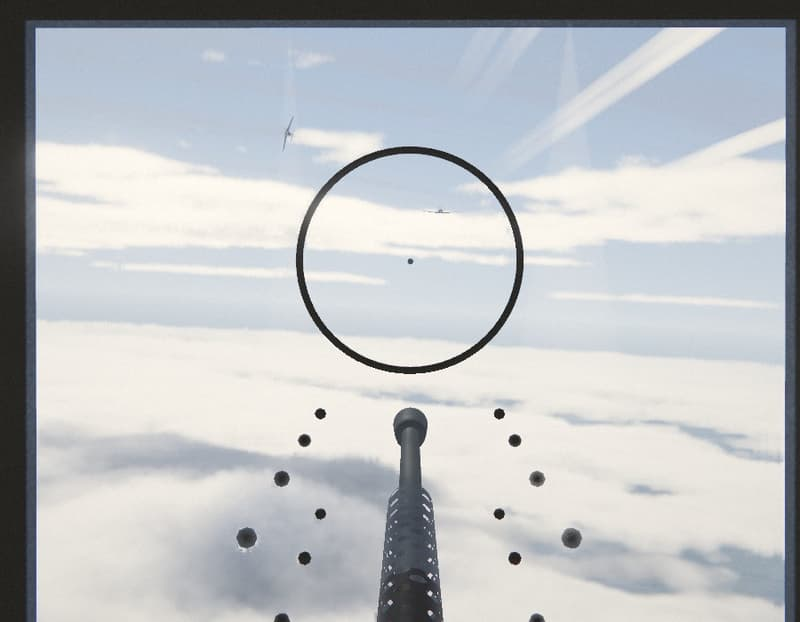 | 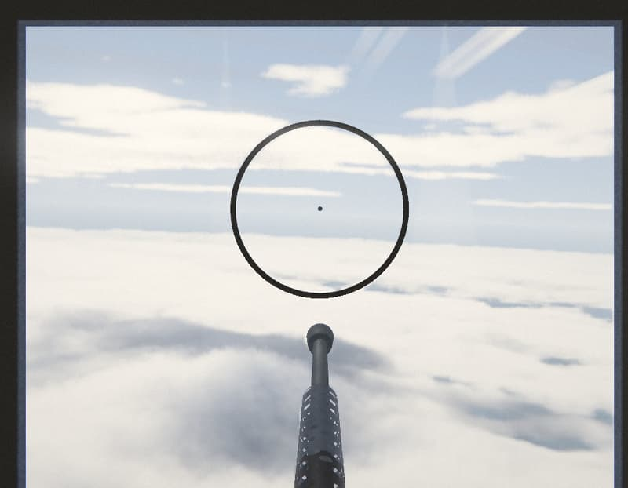 |
| **Stale sky reflections after a weather change.** Interiors of stations the player was not manning (and anything else out of the scene) missed the env-map retarget. One change later their map was disposed. The tail glass and guns then mirrored the old day sky at night. Every replaced env map is now remembered, and `Engine.sortLayers` points any material still holding one at the current sky (`AircraftLook.freshEnv`). | 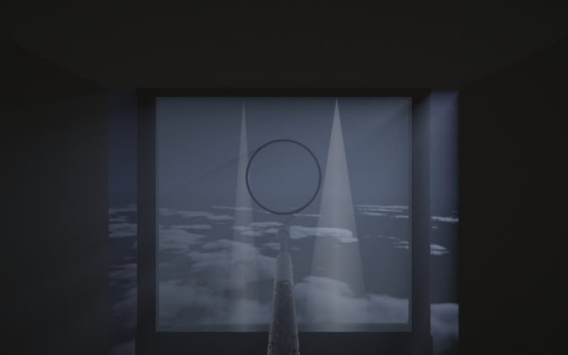 | 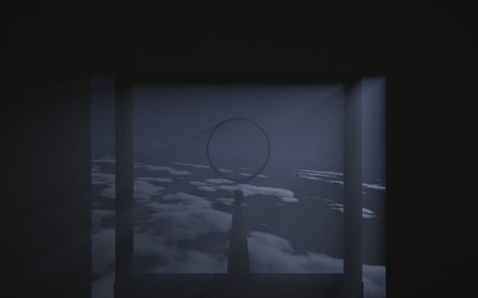 |
| **Tail window: two white cones at night.** The additive reflection streaks were unlit white, so at night they stood as two bright light cones in the window. They now take the sky's horizon colour: warm at dusk, nearly invisible at night (`Viewmodels.ts`). Same pair of images as the row above. | | |
| **P-51 cockpit: pale veil over the whole view.** Seen from inside, the two-sided canopy mirrored the sky env at x1.6. A storm sky came out at 189/255 instead of 79, and dusk lost its colour. The player's own canopy now gets its own material, and from the cockpit it uses 16 % of the env intensity. Chase view and other P-51s are unchanged (`PilotController.ts`). | 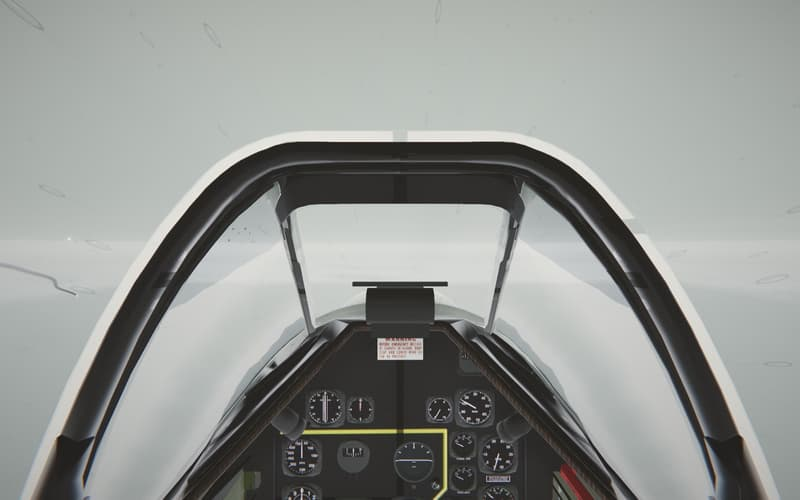 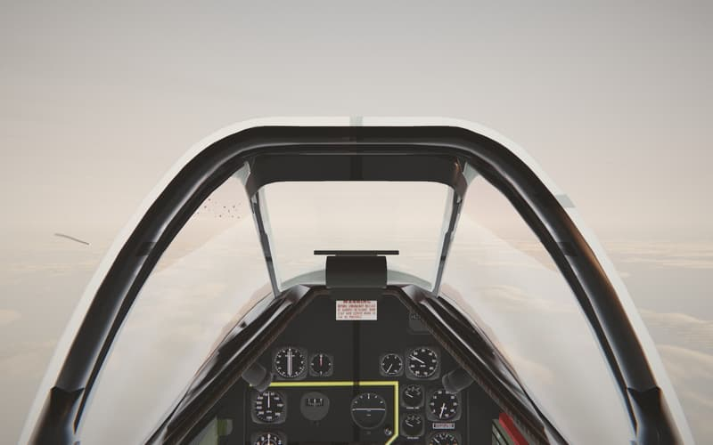 | 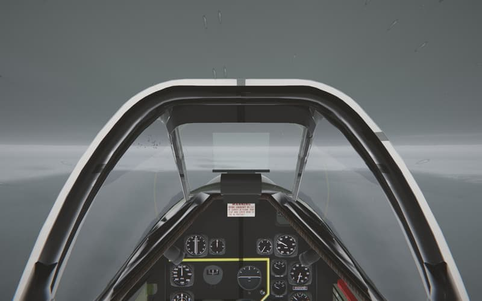 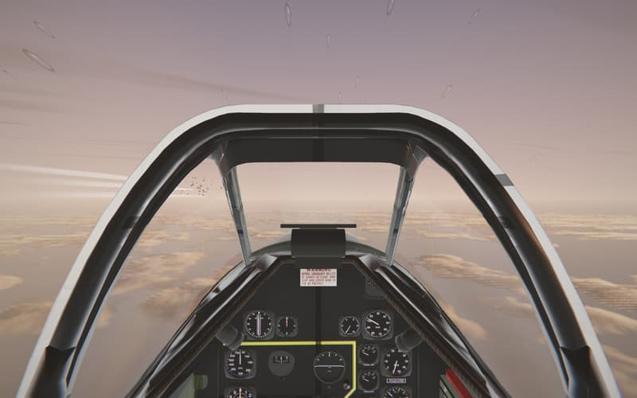 |
| **Horizontal banding while climbing through the cloud deck** (take-off, about 15-21 s). With the camera inside a layer, grazing rays ran tens of km through the slab with steps about 1 km apart. That left static step noise the temporal resolve could not settle. Inside a layer the march now stops 8 km out (murk), and the cap eases off over the last 500 m before the layer's top or base. Views from above or below a layer are unchanged, and nothing pops (`Clouds.ts`). | 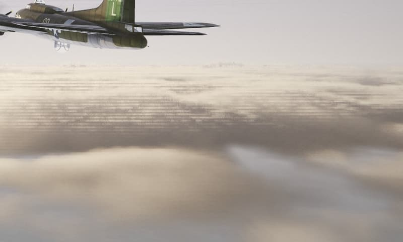 | 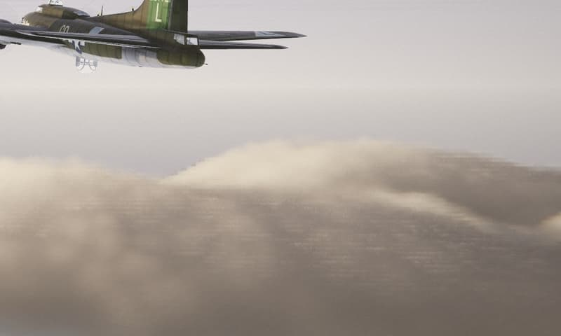 |
| **Boss HUD covering the streak meter.** On screens 1250 px or wider, the battle-group bar (2D overlay, y 22) sat on the streak meter and the "H — controls" hint at the top centre. It now starts below them, at y 78 (`BossHud.ts`). | 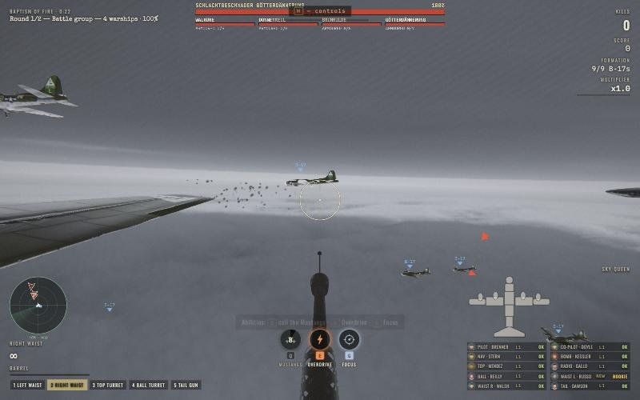 | 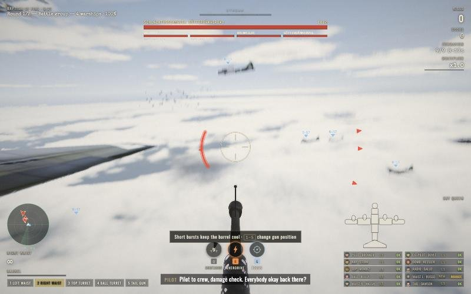 |

## Polish pass (follow-up to the recommendations)

Images in `polish/` (`before-*` / `after-*`, same view and seed set-up through `sws.vqa`; the
`low-*` set is Low quality). Every frame scanned clean: no NaN/Inf, no hot texels, no black or
clipped clusters.

| Issue | Change | Before | After |
|---|---|---|---|
| **Explosion shock ring at night** | The ring's brightness follows the daylight (`shockLight()`, from the sun intensity and the fill): 1 on a clear day, ~0.4 at dusk, ~0.3 in a storm, ~0.035 at night. The legacy ring sprites use the same factor (`Explosions.ts`, `Effects.ts`). | 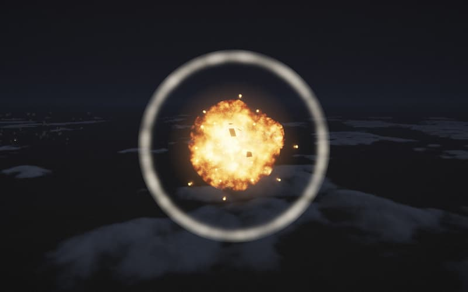 | 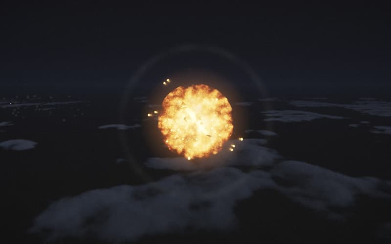 |
| **Debris and ember trails as beads** | Puffs are placed along the path flown since the last emission, with jitter and varied size and density, and spawned already as old as they would be had they been emitted there (new `ParticleOpts.age`). Debris flames are spaced by distance (0.3 of a flame's size). A tumbling wreck's emitter swings round the piece, so `Effects.trail` takes the emitter's previous position and follows its real path. The damaged-engine and wreck trails pass the time since the last call (`Effects.ts`, `Wrecks.ts`, `World.ts`, `Particles.ts`). | 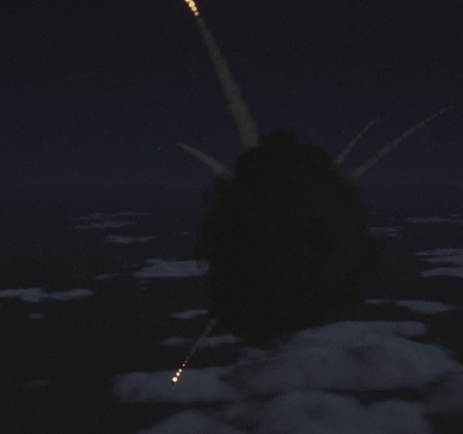 | 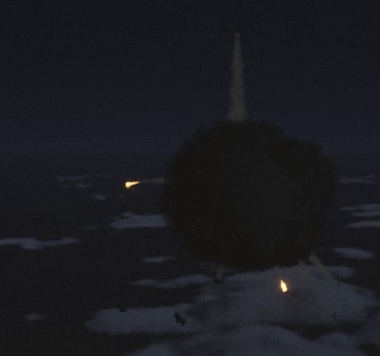 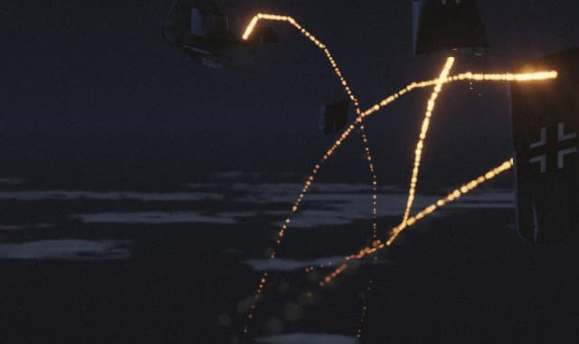 |
| **K-14 glass as a pale rectangle** | The reflector glass is additive with a black diffuse at 0.22 opacity: it adds only a faint reflection and sun glint, never a tint. Seen from the seat it mirrors the bright cloud sea (the sky env), where a real one mirrors the dark cockpit. Blending is GL state, so no new program (`PilotController.ts`). | 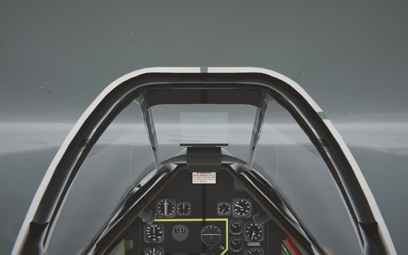 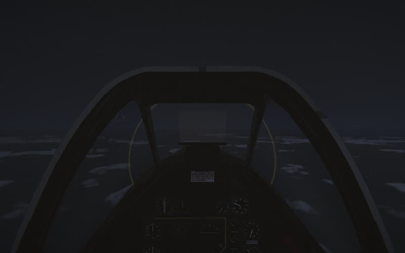 | 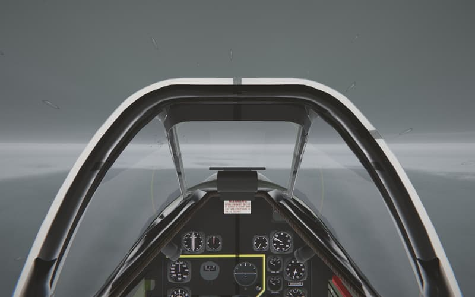 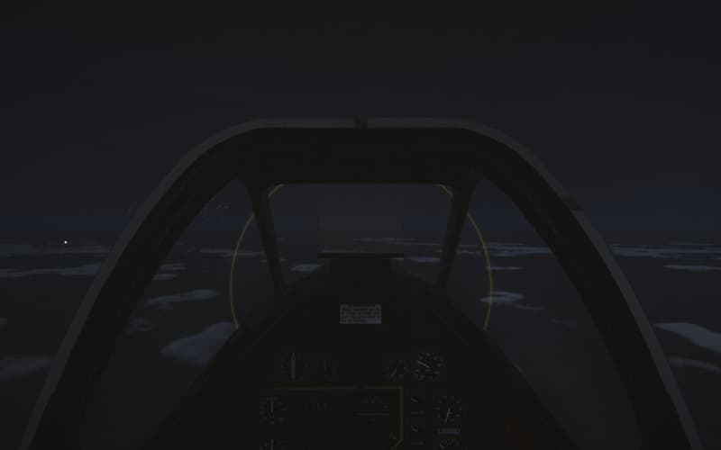 |
| **White bullet-hole rims** | Rims are sooty torn metal (0x4d4a44, roughness 0.62, metalness 0.5) on the player's B-17 and on the fighters (`PlayerBomberDamage.ts`, `DamageStages.ts`). | 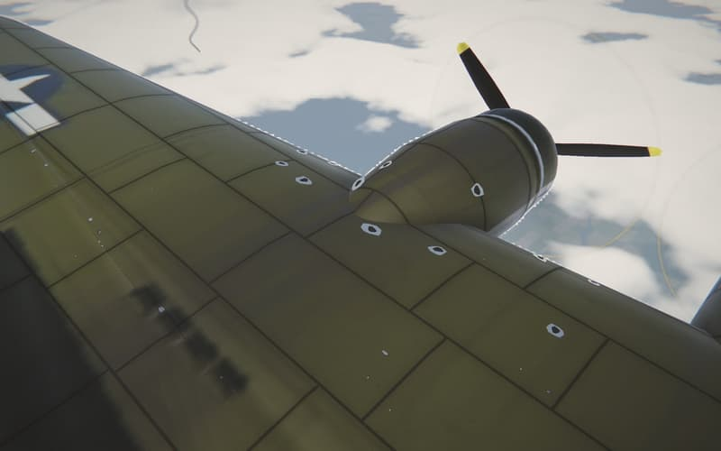 | 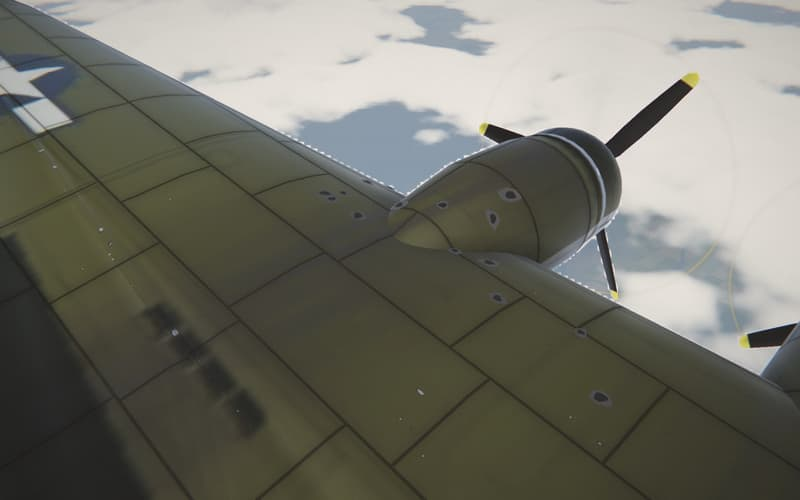 |
| **Searchlight beams start in mid-air** | The near-lamp cut fades with the camera's height above each lamp (vertex shader, from `modelMatrix`): none below ~250 m, full from ~1200 m. From the ground and low the beam starts at the lamp; from the night fighter's altitude there are still no lamp blobs (`Searchlights.ts`). | 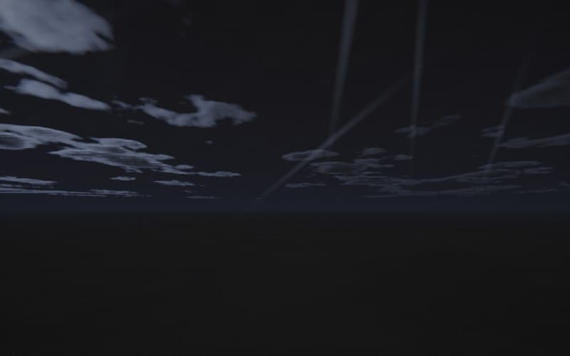 | 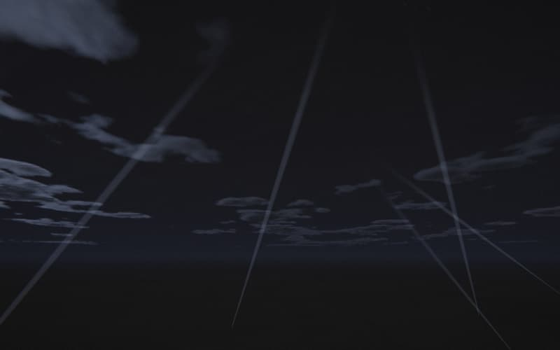  |
| **Debrief after landing cut to altitude** | After the landing the field stays behind the debrief (`Bookends` 'hold'): the Sky Queen parked where she stopped, engines winding down, a slow camera drift round her, faded in. `Game.startMenu` / `showBriefing` call `bookends.release()` first, and any other state change releases it. It steps aside (and comes back) for the best-moment replay and the replay theatre, which play over the live world (`Bookends.ts`, `Cinematics.replaying`, `Theatre.openLive`). | 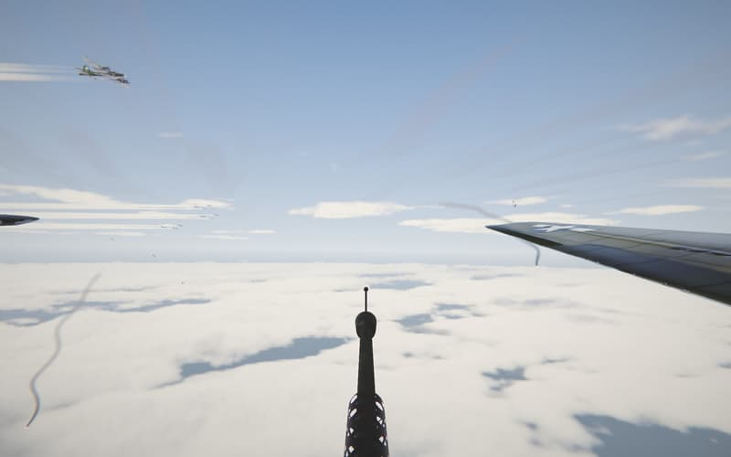 | 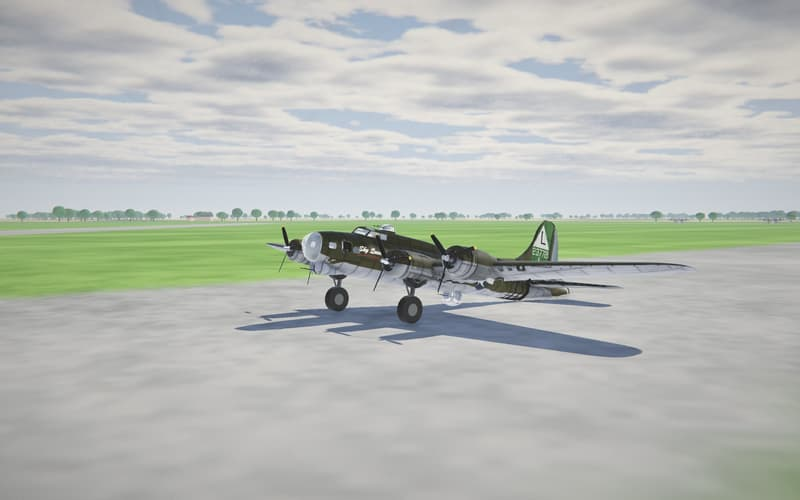 |
| **Night fill ~80 % of day** | The hemisphere intensity keeps its 70 % floor down to dusk/storm light, then falls to ~34 % of the day's at night. The rim chunk sees how far the fill is below dusk (from the sky colour it gets: no uniform, no new program) and gives back light only near the camera: the rim within ~25-60 m (the player's P-51 in chase, his own B-17 from the guns), part of the fill within ~3-9 m (cockpit, fuselage interior). Enemies further out are darker (their 90th-percentile brightness 41 to 32 in the Ju 88 view); exhaust flames, searchlights and flares find them (`AircraftLook.ts`). | 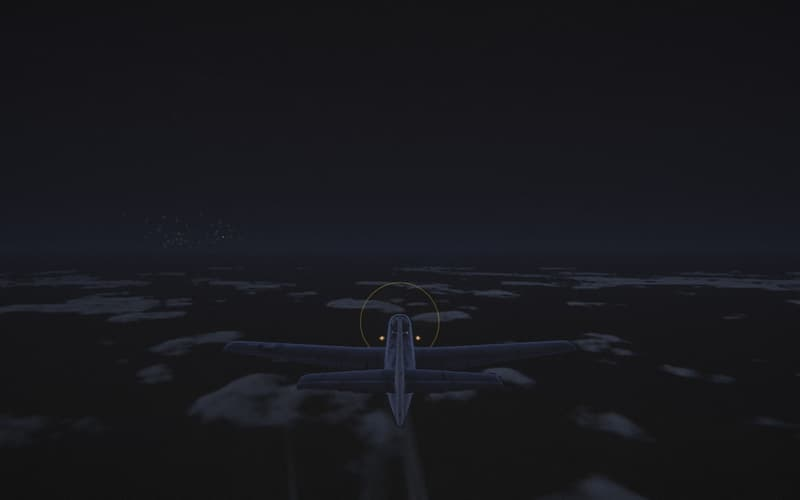 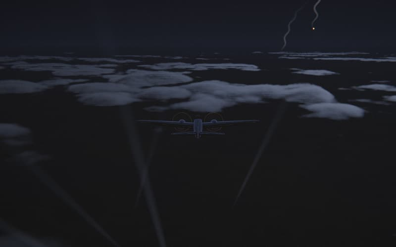 | 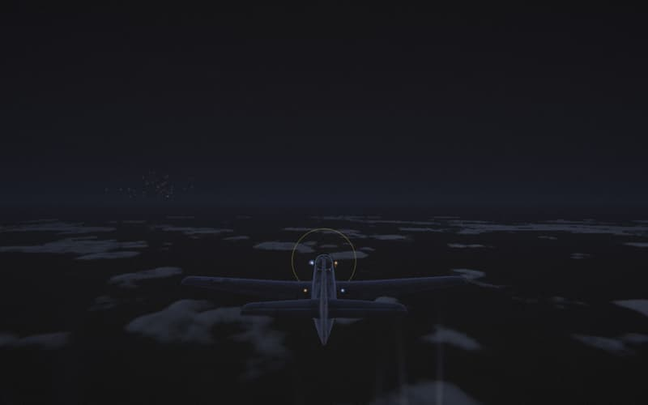 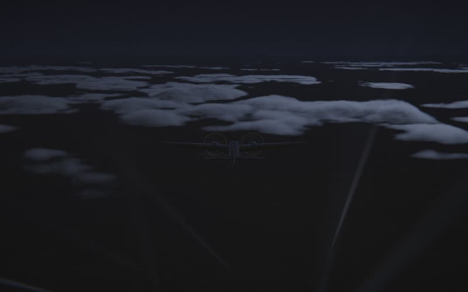 |

Tried and left out: more march steps for rays close to level with the camera near the deck top
(end of the take-off climb). An A/B on the same frozen frame showed no visible change to the
stipple, and the finer steps drew a hard thin line of far cloud on the horizon. The remaining
grain there looks like temporal resolve noise rather than step spacing.

## Not fixed: recommendations (design, not bugs)

- **Cloud tops seen from just above the deck** (end of the take-off climb, around 6000 m): grazing
  rays still show stipple. A cap there would cut the cumulus sea, because grazing rays reach the
  dense part kilometres past entry. More steps alone did not help (see the polish pass); a step
  distribution that follows density, or blue-noise jitter on the temporal path, is still open.
- **Low quality interiors** have no shadow map, so the sun lights the inside of the fuselage
  through the hull. The waist and radio room are brighter and greener than on the other tiers. It
  looks readable, not broken.
